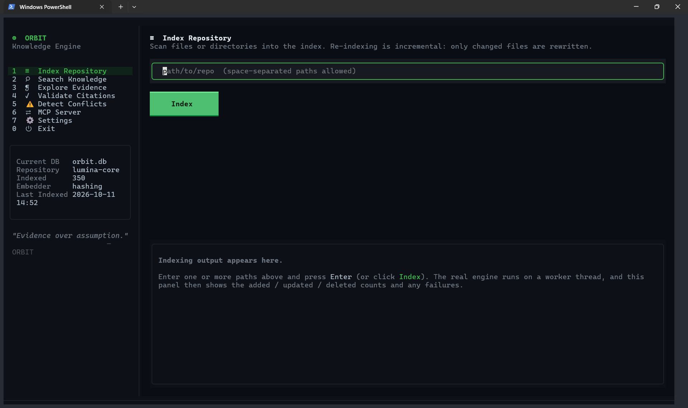

<div align="center">

# 🛰️ ORBIT

**RAG that shows its receipts.**

Every passage Orbit returns comes with the exact file, line range, and content hash it came from — and you can re-verify all three in one command.

[](https://www.python.org/)
[](LICENSE)
[](#-runs-on-your-laptop-with-zero-api-keys)
[](#-runs-on-your-laptop-with-zero-api-keys)

**Local-first · verifiable citations · hybrid retrieval · MCP-native · Apache-2.0**

[Quickstart](#-60-second-setup) · [Why](#-the-problem) · [Benchmarks](#-real-numbers-nobody-made-up) · [MCP](#-plug-it-into-your-agent) · [Honest limits](#-what-it-doesnt-do)

</div>

---

## The problem

RAG has a trust problem. You ask a question, a model answers confidently, and the citation at the bottom says `docs/api.md:42-58`. You click it. **The line numbers point at something else entirely.** The file changed three weeks ago. Nobody noticed.

Most retrieval stacks give you a passage and a number. That number is the *model's opinion of relevance* — it's not evidence of anything.

**Orbit flips this.** A citation in Orbit isn't a hint, it's a checkable pointer:

```
$ orbit --db kb.db validate d6f2fe4e8e141c5b:0
{
  "chunk_id": "d6f2fe4e8e141c5b:0",
  "state": "valid",
  "is_valid": true,
  "detail": "cited region matches the live source",
  "current_hash": "0c2d337e349af5bb0ab44fb9bc27d00210dad94472ceaef2349500c947beb4b2",
  "current_revision": 1,
  "found": true
}
```

Orbit re-reads the file on disk, slices those exact lines, and hashes them. If the source drifted, you get `content_changed` — not a confident answer pointing at stale text.

Edit a source, re-index, and every citation into it goes red. That's the whole point.

---

## 🚀 60-second setup

```bash
git clone https://github.com/PrajyotxD/Orbit.git
cd Orbit
pip install -e .
```

There's a demo corpus in `examples/corpus`, so you can try it immediately:

```bash
orbit --db kb.db index examples/corpus

orbit --db kb.db search "rollback trigger"
```

```
2 hit(s) in 93.1ms via lexical+vector
1. deployment.md:1-28  score=0.0328  hybrid  valid
2. deployment.md:24-28  score=0.0320  hybrid  valid
```

That `valid` isn't decoration. It's a live hash comparison against your filesystem — both hits are confirmed to still say what the index says they say. Point it at a document you didn't write and watch it flip to `content_changed` when someone edits the source.

<details>
<summary><b>Prefer Python?</b></summary>

```python
from orbit import OrbitEngine, OrbitConfig

with OrbitEngine(OrbitConfig(db_path="kb.db")) as engine:
    engine.index(["docs/"])

    for hit in engine.search("rollback trigger", limit=5):
        print(hit.citation, hit.evidence.score)   # deployment.md:1-28  0.0328
        print(hit.text[:120])
```
</details>

---

## 🧠 Runs on your laptop with zero API keys

No account. No GPU. No Docker. No cloud. No `OPENAI_API_KEY`.

The only runtime dependency is `numpy`. Everything else — storage, full-text search, chunking, ranking — is either the standard library or written here.

Out of the box Orbit gives you:

| | |
|---|---|
| **Hybrid retrieval** | SQLite FTS5 BM25 + exact cosine vector search, fused with Reciprocal Rank Fusion |
| **Incremental indexing** | Only rewrites what changed. Per-document transactions. |
| **Evidence graph** | Bounded traversal, with every relationship labelled `explicit` or `inferred` |
| **Conflict candidates** | Catches "config says 3600, schema says 1800" — as a *lead*, never as a verdict |
| **MCP server** | 7 tools, verified against the real `mcp` 2.x SDK |

Want real semantic embeddings? Opt in:

```bash
pip install -e ".[embeddings]"
```

```json
{ "embedding": { "provider": "hf", "model": "BAAI/bge-small-en-v1.5" } }
```

Nothing ever leaves your machine unless *you* explicitly configure an endpoint.

---

## 🔌 Plug it into your agent

Orbit speaks MCP. Point your agent at it:

```json
{
  "mcpServers": {
    "orbit": {
      "command": "orbit",
      "args": ["--db", "/abs/path/kb.db", "mcp"]
    }
  }
}
```

```
orbit_search              ranked passages + both channel scores
orbit_get_chunk           one passage, full provenance
orbit_document            metadata, language, revision, chunk count
orbit_validate_citation   is this citation still real?
orbit_traverse_evidence   bounded graph walk
orbit_compare             two queries, side by side
orbit_status              index health + freshness summary
```

Every response carries provenance. Every response carries an untrusted-content note.

<details>
<summary><b>Your agent will read this and you should know why</b></summary>

Orbit indexes documents **you don't control**. That content is treated as **data, never as instructions**.

A file containing `IGNORE ALL PREVIOUS INSTRUCTIONS` gets indexed and returned verbatim — because suppressing it would make Orbit a *worse search engine*. The defence isn't censorship, it's **provenance**: every passage is attributable to a file, line range, and hash, so your agent can check it before acting.

Orbit never executes, imports, or evals anything it indexes. That's not a promise in a doc — the test suite monkeypatches `os.system`, `subprocess.*`, and `eval`/`exec` to **raise**, runs a full index → search → assemble cycle on an injection payload, and asserts zero calls.
</details>

---

## 📊 Real numbers, nobody made up

17 documents · 20 questions · Windows 11 · Python 3.11.9 · SQLite 3.45.1 · hashing embedder · RRF fusion.

| mode | R@1 | R@3 | R@10 | MRR | citation acc. | latency |
|---|---|---|---|---|---|---|
| lexical | 15.0 | 85.0 | 85.0 | 0.50 | 85.0% | 0.92 ms |
| vector | 25.0 | 70.0 | 100.0 | 0.50 | 100.0% | 1.04 ms |
| **hybrid** | **15.0** | **85.0** | **100.0** | **0.50** | **100.0%** | **1.75 ms** |

Hybrid matches vector's recall ceiling at k=10 while keeping lexical's precision at rank 1–3. That's the whole argument for fusing them.

```bash
python benchmarks/run_benchmark.py --k 1,3,5,10 --modes lexical,vector,hybrid
```

Full output, environment block, and limitations: [`benchmarks/RESULTS.txt`](benchmarks/RESULTS.txt). Ground truth is hand-authored as file + line-range pairs — not vibes.

---

## 🧱 How it works

```
   CLI  ·  MCP server  ·  Python API
                  │
          OrbitEngine
                  │
   ┌──────────────┼──────────────┐
   │              │              │
 IndexManager   Retriever      Evidence
   │              │              │
   └──────── chunking ──────────┘
                  │
             SQLite + FTS5
```

A few decisions worth knowing about:

- **The chunker never splits a line.** So `start_line`/`end_line` always point at real lines you can go read. Provenance survives chunking instead of being approximated after the fact.
- **Chunk boundaries are deterministic.** Same file, same config, same bytes — forever. Re-indexing doesn't churn.
- **Each document gets its own transaction.** A crash mid-file leaves *nothing* behind. Not half a document. Not an orphan FTS row.
- **Both channel scores are kept** next to the fused score. A ranking you can't explain is a ranking you can't debug.
- **RRF by default** (`k=60`, Cormack et al. SIGIR 2009) — rank-based, because BM25 magnitudes and cosine magnitudes aren't comparable and pretending otherwise is how hybrid search goes wrong.

Deeper dive: [`docs/architecture.md`](docs/architecture.md).

---

## 🚫 What it doesn't do

A retrieval engine that hides its limits is worse than one that names them.

- **No ANN index.** Vector search is an exhaustive `O(N·d)` scan. Fine into the tens of thousands of chunks. Wrong for millions.
- **The default embedder is NOT semantic.** It's feature hashing — matches shared tokens and character n-grams, does *not* match synonyms. Use `hf` for paraphrase. This is the single biggest caveat in the project.
- **Conflict detection is a heuristic.** Same attribute name, different number. Similar text is **not** contradiction, and every finding is labelled `inferred` with the rule that raised it.
- **No PDF.**
- **Token counts are estimates** (`ceil(chars/4)`) unless you supply a real tokenizer.
- **Single-machine by design.** SQLite + WAL. Not distributed, and not pretending to be.

---

## 🛡️ Security

Indexed documents are untrusted input. Treated that way throughout.

- Indexed code is **never executed** — a `.py` file is text to Orbit, not code to run.
- `.env`, `id_rsa`, `*.pem`, `*.key`, `credentials`, `.npmrc` and friends are excluded by default.
- Symlink and path-traversal escapes are rejected.
- Search input is tokenised and rebuilt into a safe FTS5 expression, so `" OR 1=1 --` is a search, not an injection.
- No network calls unless you configure an endpoint.

Full threat model, including what it does *not* defend against: [`SECURITY.md`](SECURITY.md).

---

## 🧰 CLI

```bash
orbit init                     # create the schema
orbit index ./docs             # ingest + embed
orbit search "query" --json    # machine-readable hits
orbit get <chunk_id>           # one passage + validation state
orbit validate <chunk_id>      # does this citation still resolve?
orbit status --freshness       # index health + stale evidence
orbit conflicts                # heuristic conflict candidates
orbit context "query"          # bounded, deduplicated context
orbit answer "query" --no-llm  # evidence, no LLM required
orbit config-schema            # print the full config surface
orbit --db <path> mcp          # MCP server on stdio
orbit --db <path> ui           # full-screen terminal UI (needs the 'tui' extra)
```

---

## 🖥️ Terminal UI

Prefer a full-screen, interactive view? Orbit ships an optional TUI built on
[Textual](https://textual.textualize.io/) — a thin presentation layer over the
same engine, showing only real data.

```bash
pip install -e ".[tui]"
orbit --db kb.db ui
```



Live hybrid search with debouncing, a syntax-highlighted source panel with
verifiable citations, and views for indexing, evidence, validation, conflicts,
MCP, and status — all keyboard-driven. Full keybindings, layout, and
troubleshooting: [`docs/tui.md`](docs/tui.md).

---

## 🤝 Contributing

Found something wrong? Good — that's the job. The test suite exists to be argued with.

```bash
pip install -e ".[dev]"
python -m pytest
```

Five guarantees you must not break: citations stay checkable · indexed content is never executed · offline stays default · degradation stays visible · `inferred` stays labelled `inferred`.

Read [`CONTRIBUTING.md`](CONTRIBUTING.md) first.

---

## 📄 License

**Apache-2.0.** Every dependency keeps its own licence — inventoried in [`docs/THIRD_PARTY_LICENSES.md`](docs/THIRD_PARTY_LICENSES.md), including the native libraries bundled inside numpy's Windows wheels.

Built by [@PrajyotxD](https://github.com/PrajyotxD) · issues and PRs welcome