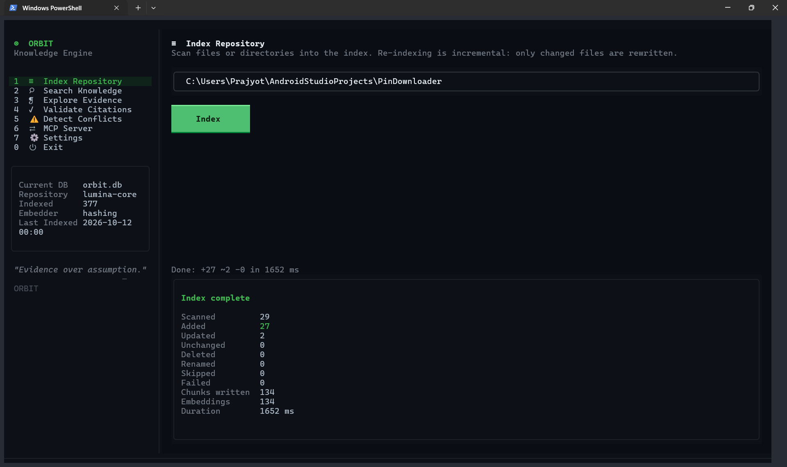
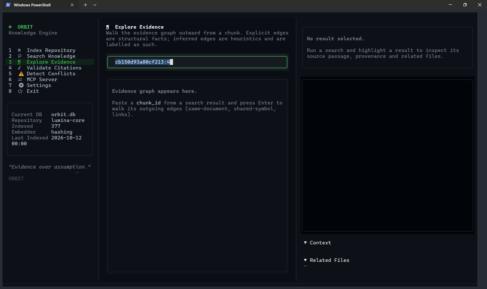
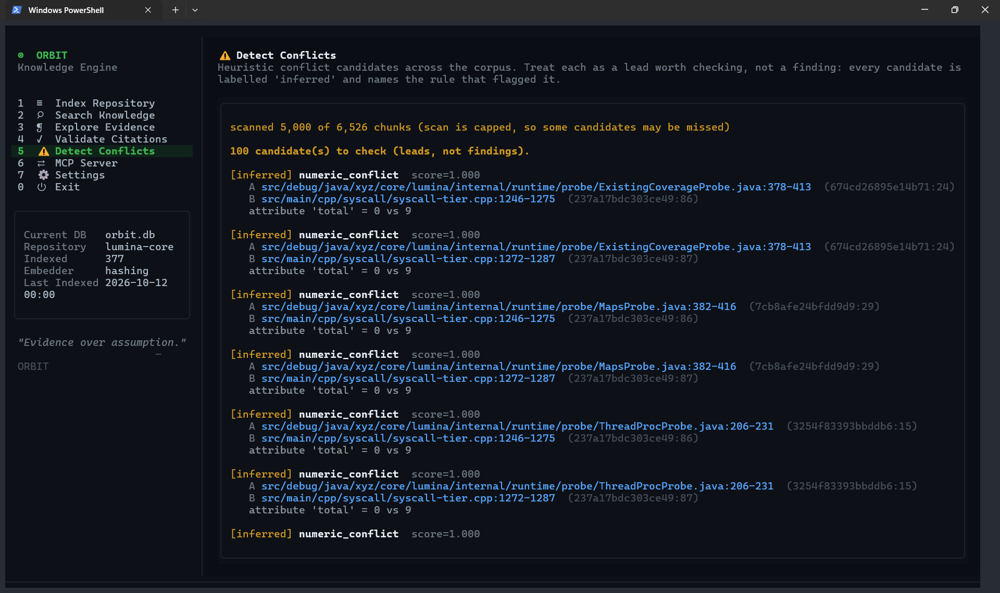
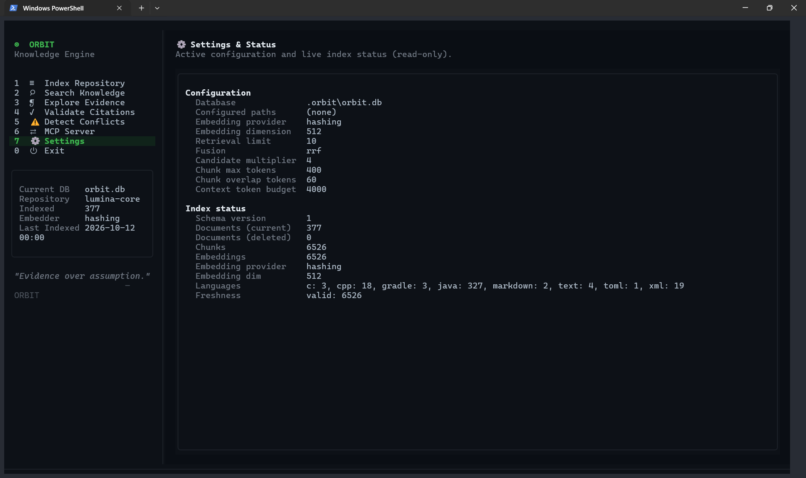

# Orbit TUI — full-screen terminal UI

Orbit ships an optional full-screen terminal UI built on
[Textual](https://textual.textualize.io/). It is a thin layer in front of the
existing engine. It does no retrieval, indexing, or validation of its own, and
every number on screen comes from a real engine call. The non-interactive CLI,
the Python API, and the MCP server don't change and don't depend on anything
under `src/orbit/tui/`.


## Install

The UI needs the `tui` extra, which pulls in `textual` (and `rich` with it):

```bash
pip install -e ".[tui]"
# or, if Orbit is already installed:
pip install textual
```

`textual` is imported lazily. If it's missing, `orbit ui` prints a short message
telling you to install the extra instead of dumping an `ImportError` traceback.

> **Python version note.** Textual publishes wheels for the mainstream CPython
> releases. If your interpreter is newer than those wheels (say, a 3.14
> pre-release), make a 3.11 or 3.12 virtualenv for the UI:
> `py -3.11 -m venv .venv && .venv/Scripts/pip install -e ".[tui]"`.

## Launch

```bash
orbit ui                                   # uses .orbit/orbit.db (or config db_path)
orbit --db .orbit/demo.db ui               # pick a database (global flag)
orbit ui --db kb.db                        # or after the subcommand
orbit ui --index-path ./docs               # pre-fill the Index Repository field
python -m orbit.tui --db kb.db             # module entry point, identical behaviour
```

`--db` and `--config` both work before or after the `ui` subcommand (a value
after the subcommand wins), the same as every other Orbit command.

## Layout

```
┌ orbit v0.1.0 — Knowledge Engine   Database: … · Repository: … · N files ┐
│ SIDEBAR (nav 1–7, 0=Exit) │ CENTER (active view)      │ SOURCE DETAILS   │
│  logo + numbered menu     │  context-aware input,     │  file + lines,   │
│  index info box           │  live results / output    │  highlighted     │
│  tagline                  │                           │  code, context,  │
│                           │                           │  related files   │
├───────────────────────────┴───────────────────────────┴──────────────────┤
│ Up/Dn Navigate  Enter Open  e Evidence  v Validate  r Re-validate  q Quit  │
└────────────────────────────────────────────────────────────────────────────┘
```

- **Top bar** — product name and version, the active database name, a repository
  label, and the real indexed-file count. Reads `not initialized` when the
  database has no schema yet.
- **Sidebar** — numbered navigation (each number is also its hot-key) plus a live
  info box: current DB, repository, indexed count, embedder, last-indexed time.
- **Center** — a `ContentSwitcher` with one view per sidebar entry.
- **Right panel** — source details for the highlighted result: file and line
  range, the fused score, validation state, the syntax-highlighted passage (line
  numbers start at the real source line), provenance context (chunk/doc id,
  channel scores), and related passages from the evidence graph. It shows up only
  on the Search, Explore Evidence, and Validate views. On Index, Detect
  Conflicts, MCP, and Settings it's hidden, so a hit you selected on Search can't
  sit there as stale context beside output it has nothing to do with.
- **Bottom bar** — context-sensitive key hints on the left, a live status dot on
  the right (green = ready, amber = working, red = error).

## Views

| # | View | What it does |
|---|------|--------------|
| 1 | **Index Repository** | Index one or more paths (space-separated). Pick which database to index into (each repo can get its own; the field defaults to `.orbit/<repo>.db` from the path you type). Runs the real engine on a worker thread with a live progress bar, and reports the added / updated / deleted / unchanged / failed counts, chunks and embeddings written, and any per-file failures. |
| 2 | **Search Knowledge** | Live hybrid search with debouncing. Each result card shows the rank, the fused score (with the separate lexical and vector scores when present), the line range, the retrieval method, and a validation badge. Filter by category with the tab row (click a tab or press `f`). Highlight a result to populate the Source Details panel. On a selected hit, `e` jumps to Evidence and `v` to Validate; `r` re-validates every visible hit. |
| 3 | **Explore Evidence** | Walk the evidence graph outward from a `chunk_id`. Edges are labelled `explicit` (structural) or `inferred` (heuristic). |
| 4 | **Validate Citations** | Re-read the cited lines from disk and compare hashes for a `chunk_id`. Reports `valid` / `content_changed` / `path_missing` and so on. This checks provenance, not truth. |
| 5 | **Detect Conflicts** | Heuristic conflict candidates across the corpus. Each one is labelled `inferred` with the rule that raised it, so treat them as leads to check, not findings. |
| 6 | **MCP Server** | Shows the MCP launch command and the 7 tools the server exposes, and whether the `mcp` SDK is installed. The server runs as its own process, separate from this UI. |
| 7 | **Settings** | Read-only view of the active configuration and live index status: schema version, document / chunk / embedding counts, languages, freshness. |
| 0 | **Exit** | Quit and restore the terminal. |

### Screens

Index Repository, after a run — scanned / added / updated counts and chunks written:


Index Repository, empty state before a run:



Explore Evidence — walk the evidence graph from a `chunk_id`:



Detect Conflicts — inferred candidates with honest scan coverage (`scanned N of M chunks`):



Settings & Status — active configuration and live index status:



## Keyboard shortcuts

| Key | Action |
|-----|--------|
| `1`–`7`, `0` | Jump to a view (0 = Exit) |
| `↑` / `↓` | Move through the nav menu or result list |
| `Enter` | Open / run (search, index, validate, explore) or focus the Source panel from a result |
| `/` | Jump to the search box |
| `e` | (Search) Open **Explore Evidence** for the selected hit |
| `v` | (Search) Open **Validate Citations** for the selected hit |
| `f` | Cycle the result category filter (Search view); the tabs are also clickable |
| `r` | (Search) Re-validate every visible hit against disk and update the badges; on other views, refresh the active view |
| `Esc` | Blur the focused input, or return to Search |
| `q` | Quit |

Single-character bindings (`q`, `/`, `f`, digits) are suppressed automatically
while a text input has focus, so you can type a query that contains those
characters without triggering navigation.

## Filters and honest categories

The Search view groups languages into **Code**, **Docs**, and **Config**, plus
**All**. There's no **Comments** filter. Orbit indexes by file language, not by
comment spans, so a Comments tab would always come back empty, and a tab that
can never return anything is worse than no tab. The UI only offers categories
the engine can actually fill.

The tabs are clickable, so you can switch category with the mouse while the
search box still has focus. `f` cycles through them for keyboard use.

## Databases (one per repo)

Each repo can live in its own index instead of everything landing in a single
shared `orbit.db`. When several repos share one database, search mixes their
results and the top-bar repository label can only name one of them, so a
per-repo file keeps them separate and the label honest.

On the **Index Repository** view:

- The **Index into** field is the database the next run writes to. Type a path
  and it defaults to `.orbit/<repo-folder-name>.db`; override it with any path
  you like. The run creates the file if it doesn't exist.
- The **Database** selector lists the `*.db` files next to the active one
  (newest first) and switches search, evidence, and validation to whichever you
  pick. Indexing into a new database selects it automatically.

The top-bar repository label follows the **most recently indexed** root in the
active database, not the one with the most files, and flags a mixed database as
`<name> (+N more)`.

## Progress and loading

Indexing shows a live progress bar and a running count of the documents and
chunks written so far, read straight from the database as the engine commits
each file (WAL lets a reader see each committed document mid-run). The engine
doesn't emit a per-file callback, so there's no fabricated percentage during the
sweep — the bar pulses and the real count climbs, then snaps to complete when
the run finishes. The conflict scan, status load, and evidence/validate lookups
each show their own working state while the worker thread runs.

## Icons and terminal setup

Every glyph in the UI is looked up by a semantic name from one of three
interchangeable sets (see `src/orbit/tui/icons.py`); nothing is hardcoded in the
view code. Pick a set with the flag, the environment variable, or the default,
in that order of precedence:

```bash
orbit ui --icons unicode   # default: single-width, non-emoji symbols
orbit ui --icons nerd      # Nerd Font glyphs (needs a patched font, see below)
orbit ui --icons ascii     # ASCII only, for the most limited terminals
ORBIT_ICONS=ascii orbit ui # same via the environment (flag wins over env)
```

- **`unicode`** (default) — every glyph is one terminal cell wide and isn't an
  emoji, so it renders the same across modern terminals and won't blow up into a
  double-width colour emoji. The test-suite checks `rich.cells.cell_len == 1` for
  all of them.
- **`nerd`** — [Nerd Font](https://www.nerdfonts.com/) glyphs. They look best,
  but they need a patched font installed and selected in your terminal; without
  one you get tofu (□) or the wrong glyph.
- **`ascii`** — ASCII only. The words carry the meaning either way, so this stays
  fully legible.

Validity never rides on an icon or a colour alone. The state word (`valid`,
`content_changed`, `missing`, and so on) is always printed next to the glyph, so
the UI reads fine in a monochrome terminal and through a screen reader.

### Recommended fonts (for `--icons nerd`)

Install a Nerd Font and select it in your terminal:

- **JetBrainsMono Nerd Font**
- **FiraCode Nerd Font**

Download them from <https://www.nerdfonts.com/font-downloads>. On Windows,
install the `.ttf` files (right-click, *Install for all users*), then set the
font in **Windows Terminal**:

1. Open Windows Terminal and press `Ctrl+,` for Settings.
2. Pick your profile (Git Bash, PowerShell, whatever you use), then
   **Appearance**.
3. Set **Font face** to `JetBrainsMono Nerd Font` (or `FiraCode Nerd Font`).
4. Save, then launch `orbit ui --icons nerd`.

Without a Nerd Font installed, stick to the default `--icons unicode` (or
`ascii`); `--icons nerd` will render boxes for the menu and status glyphs. The
`unicode` and `ascii` sets need no special font.

## Responsiveness

The layout adapts to the terminal width:

- **≥ 100 cols** — the full three-column layout.
- **70–99 cols (`compact`)** — the Source Details panel hides; search and every
  view keep working. Open a result and the details still compute behind the
  scenes; widen the terminal to see them.
- **< 70 cols (`narrow`)** — both side panels collapse so the center view gets
  the full width. Navigate by number key.

Resizing re-applies the right breakpoint live.

## Concurrency model (why it's safe)

`OrbitDB` wraps a thread-affine SQLite connection: a connection opened on one
thread can't be used from another (`sqlite3.ProgrammingError`). To stay
responsive, the UI runs its blocking work (search, indexing, conflict scans,
freshness) on Textual worker threads, so it can't just share the main engine.

The service layer (`orbit.tui.service.OrbitService`) handles that by opening a
fresh, short-lived engine per call on the worker thread, then returning
immutable snapshots that hold no live DB handle. Concurrent file access is safe
because the store runs in WAL mode (the same property the engine's
`two_engines_on_same_db` test leans on). Results go back to the UI thread
through `call_from_thread`. The test
`tests/test_tui_service.py::test_service_is_usable_from_a_worker_thread` covers
this.

## Troubleshooting

- **`the Orbit TUI needs the 'tui' extra`** — install it: `pip install 'orbit-rag[tui]'`.
- **`No module named 'textual'`, or the wheel won't install** — your Python is
  probably newer than Textual's published wheels. Use a 3.11 or 3.12 virtualenv
  (see the install note above).
- **Top bar says `not initialized`** — the database has no schema yet. Press `1`
  and index a path, or run `orbit --db <path> index <path>` first.
- **Search returns nothing on a populated DB** — check the category filter (press
  `f` to get back to **All**). The status line also reports which retrieval
  channels ran and any degraded reason.
- **Garbled colours over SSH or in a minimal terminal** — make sure `TERM` is a
  256-colour or truecolor value (such as `xterm-256color`); Textual honours
  `COLORTERM=truecolor`.
- **Exit** — press `q`, or select `0 Exit`. Textual restores the terminal state
  on the way out, including after `Ctrl-C`.

## Testing

```bash
# service layer (headless, no terminal needed)
python -m pytest tests/test_tui_service.py

# headless Textual pilot tests (navigation, search, filters, index, validate,
# conflicts, mcp, responsive layout, clean exit)
python -m pytest tests/test_tui_app.py

# the whole suite (TUI tests skip automatically when textual is absent)
python -m pytest
```

The app tests drive the real UI through Textual's `App.run_test` pilot and
assert against real engine output: ranked hits, validation states, conflict
candidates, and the live file count. Nothing is mocked.
